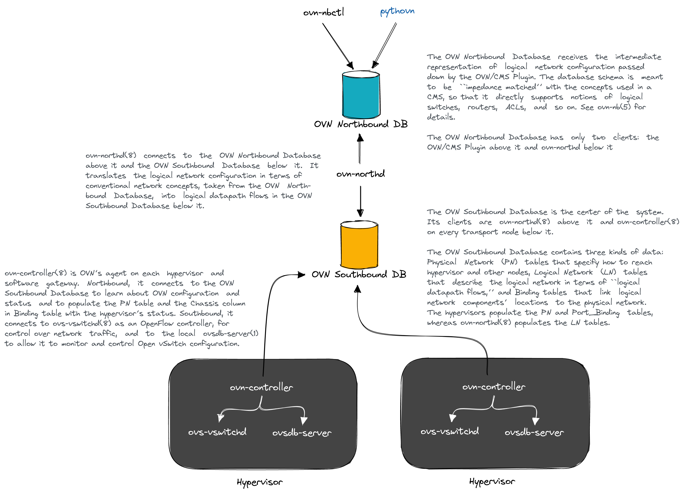
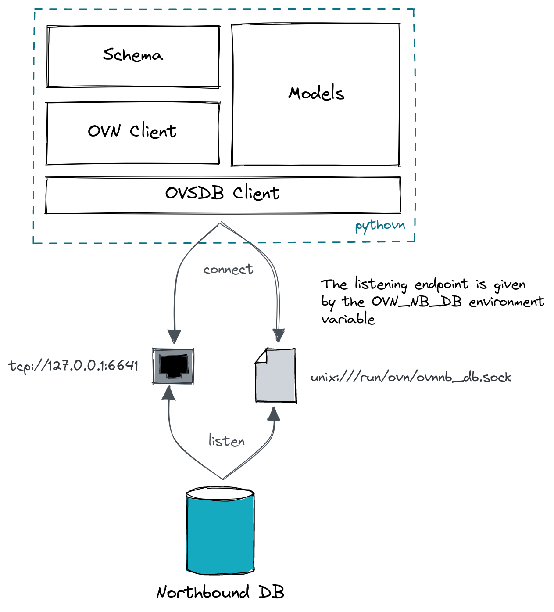

# Pythovn

Script [Open Virtual Network](https://github.com/ovn-org/ovn) with python

Many technologies exist to deploy infrastructures, like all the Infrastructure as Code (IaC) ecosystem. They rely on a declarative approach where you feed them with a configuration file. This python package rather aims to script a network infrastructure (OVN precisely).

## Install

```shell
pip install ovn
```

## Quick example

```python
from pythovn.models import LogicalRouter, LogicalSwitch

# create a network object
switch = LogicalSwitch(name="sw0")
# save it to the OVN database (yes OVN works like that)
switch.save()

# another object
router = LogicalRouter(name="ro0")
router.save()

# connect them!
switch.plug(router,
            mac="00:11:22:33:44:55",
            networks="192.168.100.1/24")

```

## High-level network use cases

Use `ovn.usecases` to compose models for common workflows. For example:

```python
from ovn.usecases import create_tenant_network

tenant = create_tenant_network(
    name="app",
    subnet="10.0.1.0/24",
    gateway="10.0.1.1",
    router_port_mac="00:11:22:33:44:55",
)
```

The module also provides helpers for workload attachment, outbound NAT,
ACL policies, and load-balancer service endpoints. Multi-step workflows
are not atomic; failures may leave earlier rows in place.

## Architecture

First, it may be relevant to well understand the overall architecture of OVN. See the [official documentation](https://www.ovn.org/support/dist-docs/ovn-architecture.7.html), sum-up below.



`pythovn` is a simple OVN Northbound client. It manages the database and then OVN does its job.


